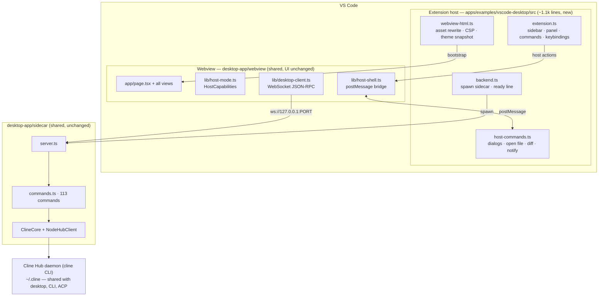

# RFC 0001: Host the VS Code extension on the desktop app's core

| | |
|---|---|
| **Status** | Draft |
| **Author** | Max Paulus |
| **Prototype** | `apps/examples/vscode-desktop` (this branch) · demo: `~/Desktop/Screen Recording 2026-10-26 at 12.10.32 PM.mov` |
| **Decision needed by** | _TBD_ |

## Summary

Replace the VS Code extension's own UI (`apps/vscode/webview-ui`, 50k lines)
and its own backend adapter (`apps/vscode/src`, 87k lines) with the desktop
app's webview and sidecar, hosted inside a ~1,100-line VS Code shell. The
shell owns only what is genuinely VS Code's: sidebar/panel, commands and
keybindings, the diff editor, opening files, dialogs, notifications, theme
and font.

Net effect: **one UI and one command surface shared by desktop, VS Code and
(next) JetBrains**; ~196k lines of duplicated code deleted; ~3.5k lines of
VS Code-native integrations ported into the shared core.

A working prototype exists. The unmodified desktop webview runs in the VS
Code sidebar, talks to the unmodified sidecar over its own WebSocket
transport, follows the editor theme live, opens files in editor tabs, and
opens agent changes in VS Code's native diff editor.

## Motivation

The SDK migration moved the extension's *brain* onto `@cline/core`. It left
two *bodies*:

| | `apps/vscode` | `apps/examples/desktop-app` |
|---|---|---|
| UI | `webview-ui/` (50,367 lines) + gRPC client | `webview/` (Next.js) + WebSocket client |
| Backend adapter | `src/sdk/` (24,985) + `src/core/controller/` (10,514) | `sidecar/` (19,372) |
| Protocol | protobuf/gRPC over `postMessage`; 3,830 lines of `.proto` | JSON-RPC over WebSocket; 113 commands |
| Settings UI | `components/settings` (13,633) | `views/settings` |

Every feature lands twice, drifts, and is fixed twice. Measured today (files
mentioning the feature, non-test):

| Feature | extension | desktop |
|---|---|---|
| hooks | 100 | 42 |
| auto-approve | 38 | 5 |
| Plan/Act mode | 31 | **0** |
| browser tool | 17 | **0** |
| `.clineignore` | 9 | **0** |
| voice / dictation | **0** | 11 |
| routines / scheduling | **0** | ✓ |
| remote (SSH) environments | **0** | ✓ |
| cross-client session search | **0** | ✓ |

Neither side is a superset. Users of each product miss features the other
has, and the team pays twice for every change.

## Proposal

### Architecture

### Ownership

| Concern | Owner |
|---|---|
| Window chrome, sidebar/panel, command palette, keybindings, diff editor, open-file, folder picker, notifications, theme, font | **VS Code shell** |
| Every screen (chat, sessions, settings, providers, MCP, marketplace, routines, account) | **shared webview** |
| Every behaviour (sessions, approvals, providers, MCP, git, cloud, remote) | **shared sidecar → `@cline/core`** |

### Host mode

The webview detects its shell once (`lib/host-mode.ts`) and exposes
*capabilities*; UI code never checks the mode directly:

| capability | desktop | vscode | web |
|---|---|---|---|
| `canQuit` | ✓ | — | — |
| `hasIntegratedTerminal` | ✓ | — | — |
| `hasFileBrowser` (in-webview Files/Changes panes) | ✓ | — | ✓ |
| `opensDiffsExternally` | — | ✓ | — |
| `ownsTheme` / `ownsFontSize` | — | ✓ | — |
| `ownsKeybindings` | — | ✓ | — |
| `hasAppIcon` / `hasAutoUpdate` | ✓ | — | — |
| `ownsWorkspace` | — | ✓ | — |

A JetBrains host adds a column, not a branch.

### Changes to the desktop app (small, additive; all in the prototype)

- `webview/lib/{host-shell,host-mode,host-appearance,host-diff}.ts` — new, ~450 lines
- `desktop-client.ts` — route host-claimed commands to the host before Tauri/WebSocket (~20 lines)
- `sidecar/server.ts` — `CLINE_SIDECAR_TRUSTED_ORIGINS` accepts `scheme://*` (VS Code mints a random `vscode-webview://` origin per view)
- Settings/General, sidebar nav, `PageFrame` — hide host-owned rows / tighten layout by capability
- `page.tsx` — host-action subscription; turn receipts open host diffs when `opensDiffsExternally`

The Tauri app's behaviour is unchanged (`hostCapabilitiesFor("desktop")` is all-true; desktop suites pass).

## Inventory: delete / port / decide

Line counts are non-test source in `apps/vscode`; tests in parentheses.
"Delete" means the functionality already exists in the sidecar or `@cline/core`.

### Delete (≈196k source + ≈60k tests)

| Path | Lines (tests) | Replaced by |
|---|---|---|
| `webview-ui/` | 50,367 (13,008) | `desktop-app/webview` |
| `src/sdk/` | 24,985 (29,707) | `sidecar/` — the SDK adapter, written once |
| `src/core/controller/` | 10,514 (3,096) | `sidecar/commands.ts` |
| `src/shared/` | 8,120 (2,666) | proto conversions & `ExtensionMessage`; gone with gRPC |
| `src/services/telemetry/` | 3,783 (1,510) | `@cline/core` telemetry + sidecar observability (**see Telemetry**) |
| `src/services/mcp/` | 3,224 (2,664) | `sidecar/mcp.ts`, `mcp-oauth.ts` |
| `src/core/storage/` | 3,042 (1,870) | `@cline/shared/storage` |
| `src/core/hooks/` | 2,773 (4,838) | `@cline/core` hooks |
| `src/core/context/` | 1,863 (2,009) | `@cline/core` context management |
| `src/hosts/vscode/hostbridge*` | ~1,400 | host-shell `postMessage` bridge |
| `src/standalone/` | 1,209 (290) | JetBrains hostbridge → JetBrains host shell (separate RFC) |
| `src/core/{workspace,mentions,prompts,locks,webview,api}` | 2,513 | `@cline/core` / sidecar |
| `src/services/{error,auth,search,banner,feature-flags,cloud,account,glob,temp,uri,logging}` | 4,300 (2,298) | sidecar equivalents |
| `src/hosts/external/` | 646 (228) | — |
| `src/utils/`, `src/dev/`, `src/test/`, `src/exports/`, `src/integrations/misc/` | 9,900 (6,319) | mostly supporting the above |
| `proto/` + `bun run protos` + generated code | 3,830 | — |

### Port into the shared core (≈3.5k source) — engineering, not deletion

| Path | Lines | Why keep | Where it goes |
|---|---|---|---|
| `src/hosts/vscode/terminal/` + `src/integrations/terminal/` | 2,412 | Shell-integration output capture, hang detection, OSC 633 parsing. VS Code's terminal beats a PTY in a webview. | `RuntimeCapabilities` override in the shell: `executeCommand` runs in a VS Code terminal |
| `VscodeEditPreview`, `DecorationController`, `VscodeDiffContentProvider`, `src/integrations/editor/` | 960 | Live streaming of edits into the open editor as the model writes. Desktop shows diffs after the fact. | `RuntimeCapabilities` override: file writes stream into `VscodeEditPreview`; result still flows through core |
| `src/services/browser/` | 794 | Puppeteer browser tool | **Decide**: move to `@cline/core` (desktop benefits) or drop for the SDK browser tool |
| `src/core/ignore/` (`.clineignore`) | 259 | Users rely on it | `@cline/core` — never belonged in the extension |
| `src/integrations/diagnostics/` | 77 | Problems panel → context | host-provided context source |
| `VscodeCommentReviewController`, `commit-message-generator` | ~500 | Code-lens review, commit-message command | stay in shell as VS Code commands calling the sidecar |

### Decide (product / partner owners)

| Path | Lines | Question |
|---|---|---|
| `src/integrations/openai-codex/` | 811 | Move to sidecar providers, or sunset? |
| `src/services/lg-cns-integration/`, `ocaAccount/`, `sap-config.ts` | ~700 | Enterprise integrations — owner decides port vs. sunset |
| `src/sdk/vscode-lm/` | ~300 | VS Code Language Model provider; only meaningful in VS Code. Shell-provided provider, or sunset |
| `legacy-state-reader`, `legacy-task-handling`, `vscode-to-file-migration`, `mcp-settings-legacy-migration` | ~1,500 | Keep **one** release to migrate pre-SDK users, then delete |
| `jupyter*`, `explainCode`, `improveCode`, `addToChat`, `addTerminalOutputToChat` commands | small | Keep as shell commands posting host actions; each needs an owner |

### Net

| | before | after |
|---|---|---|
| `apps/vscode` source | 86,819 | ~1,100 shell + ~3,500 ported ≈ **4,600** |
| `apps/vscode` webview | 50,367 | **0** (shared) |
| tests | 76,635 | ~2,000 shell + ported tests |
| proto | 3,830 | 0 |
| runtime deps | 89 (+52 webview) | ~5 |
| CI workflows touching the extension | 7 | 2 (test, publish) |

## Feature-parity gate

Before any user outside the team sees this, every row has an owner and a
decision. **Rollout does not start until each row is "port done" or
"sunset, announced in release notes".**

| Extension-only feature | Users care? | Decision | Owner |
|---|---|---|---|
| Plan / Act mode | **high** — vocal fanbase | port, or a very good replacement story | |
| Live edit streaming into the editor | high | port | |
| Terminal shell integration | high | port | |
| `.clineignore` | medium | port to core | |
| Checkpoint restore UI | medium | desktop has checkpoints; verify restore flow parity | |
| Auto-approve matrix (per-tool granularity) | medium | compare; desktop may be coarser | |
| Browser tool (Puppeteer) | low–medium | decide | |
| VS Code LM provider | low | decide | |
| Jupyter / explain / improve commands | low | keep as shell commands | |
| Walkthrough | low | replace with desktop onboarding | |

Features VS Code users **gain** (desktop-only today — lead with these):
voice input, routines/scheduling, remote SSH environments, cross-client
session search, cloud sessions, Composio connectors, a Hub shared with the
CLI.

## Second-order effects

### Telemetry & metrics — the item most likely to hurt after launch

- The extension has its own `TelemetryService` with **56 typed capture
  methods** (`captureTaskInitialization`, `captureTerminalExecution`,
  `captureProviderApiError`, `captureWorktreeCreated`, …). The sidecar uses
  `@cline/core` telemetry (43 capture points) plus `captureSdkError` /
  `captureDesktopError`. Event names, properties and the `clineType` /
  platform tags differ. **Dashboards and alerts keyed on extension events go
  flat silently.**
- Required before A/B: a mapping table *extension event → core event* (or
  "add" / "drop"; skeleton in Appendix A), and a `host: "vscode" | "desktop"`
  property on every core/sidecar event so per-product dashboards become a
  split of one stream. Budget ≈1 engineer-week plus analytics review.
- Rollout health must read the *new* stream from day one so cohorts compare.

### Versioning

Today: extension `4.1.26`, desktop `0.0.49`, independent changelogs and
publish workflows. After: users see desktop-webview + sidecar at some commit,
inside an extension version.

- **(a) Lockstep** — one `desktop-core` version string in both About pages.
  One answer to "what version are you on?".
- **(b) Pinned** — extension pins a sidecar/webview commit, bumps
  independently. Safer rollback; two version strings in bug reports.

Recommendation: (b) during rollout; (a) once legacy is deleted and the
sidecar is promoted out of `examples/`.

### Rollout & rollback

Reuse `apps/vscode-rollout` exactly as designed: one VSIX, `legacy/` =
today's extension, `next/` = this, PostHog cohort per window, crash fallback
pins to legacy. Two additions:

1. **Backend-ready is the health signal**, not `activate()` returning. `next`
   spawns a process; activation can succeed while the backend fails. Emit
   `extension.rollout.backend_ready` / `backend_failed`; gate cohort growth on
   it.
2. **Kill switch stops the backend too.** Forcing legacy on next window must
   `SIGTERM` the sidecar, or rolled-back users keep an orphan process.

Stages: separate preview extension ID (opt-in, 2–4 weeks) → A/B 5 % → 25 %
→ 50 % → 100 % with legacy still in the VSIX for one release → delete.

### Migration cost

- **Data: ≈free.** The SDK migration already moved task history, provider
  keys, MCP settings and global settings to `~/.cline/data`; the sidecar reads
  the same files. Verified: existing sessions and the signed-in account
  appeared in the prototype with no migration step.
- **Extension-local UI state** (217 entries in `state-keys.ts`): mostly UI
  preferences that die with the old UI. Audit the few that matter
  (auto-approve, telemetry opt-out, chat settings) and map them.
- **`settings.json`**: the extension contributes **0** settings today; nothing
  in user dotfiles breaks.
- **Keybindings**: 3 contributed today; the shell has 4 with different IDs.
  Keep old IDs as aliases (Appendix B).
- **Command IDs**: 19 `cline.*` commands. Alias for one release so user
  keybindings and other extensions calling them keep working.

### Runtime & packaging

- The sidecar needs bun or a compiled `cline`. Bundle the compiled CLI in the
  VSIX (+60–90 MB; `build-desktop-runtime.ts` already does this for Tauri) or
  require `cline` on PATH (as `apps/examples/vscode` does). **Recommend
  bundle**; PATH dependence is a support sink.
- VSIX size is a visible Marketplace metric; expect comments.
- When "CLI hosts the Hub directly" lands, `backend.ts` becomes "run `cline`,
  read its endpoint" and the sidecar process disappears. The webview side does
  not change. Not a prerequisite; a bonus.

### Hub lifecycle — a behaviour change users will notice

- Today each VS Code window is self-contained. After: a Hub daemon shared
  across windows, the desktop app and the CLI.
- Closing VS Code no longer necessarily stops a running session. Decide
  whether that is a feature (it is for CLI/desktop) and document it.
- "Hub build mismatch" between an updated desktop app and an older extension
  becomes a support category. The desktop's dialog exists; the VS Code copy
  must say "update the extension", not "update the app".
- One sidecar per VS Code window today. Cheap with a shared Hub, but confirm
  memory on a 10-window user.

