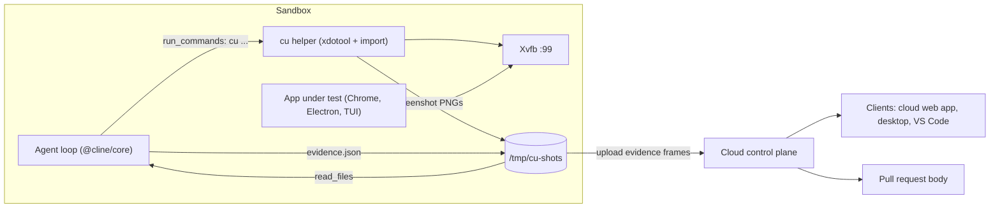

# Computer use: closing the loop in cloud sessions

Status: draft, with clickable demos in the desktop app and the VS Code extension.

## Summary

Cloud sessions already let an agent work on a GitHub repository in a sandbox, stream its tool calls to the client, and open a pull request. The missing step is the one a human engineer always takes before saying "done": run the thing and look at it.

Computer use (or "closing the loop") gives the sandboxed agent a virtual display, a way to take screenshots, and a way to click, type, and scroll. After building a feature, the agent launches the app, uses it the way a user would, looks at the result (screenshots go back to the model as image input), fixes what it finds, and picks the best frames as visual proof. Clients show that proof as a "Verified in sandbox" slideshow, and the same frames go into the PR description.

Approach: no new agent tool. The sandbox image gets standard Linux tools (Xvfb, xdotool, ImageMagick, Chrome) plus a small `cu` helper script, and a system-prompt section tells the agent how to use them. The agent drives the app with `run_commands` and looks at screenshots with `read_files`, which already returns PNG/WebP/JPEG/GIF files as image content to models with image input (`sdk/packages/core/src/extensions/tools/executors/file-read.ts`).

## Why

- Tests passing is not the same as the feature working. Layout bugs, dead buttons, broken focus handling, unreadable dark mode, and overflowing mobile layouts all pass unit tests.
- Reviewers currently have to check out the branch to see a UI change. Captioned screenshots answer "what does it look like" in seconds and make cloud PRs much easier to trust.
- Agents that can observe their output self-correct. A screenshot of a blank page after `bun run dev` is a much stronger signal than an exit code.

## Goals

- The agent can launch and drive GUI apps in the sandbox: web apps in a browser, Electron or Tauri desktop apps, and terminal UIs in a terminal emulator.
- The agent verifies its own work before completing and fixes problems it finds.
- Clients (cloud web app, desktop app, VS Code) show the proof as a screenshot slideshow.
- Screenshots are embedded in the pull request the agent opens.

## Non-goals

- A new agent tool. Everything runs through `run_commands`, `read_files`, and the prompt.
- Live remote-desktop streaming to the client, or letting the user take over the sandbox display.
- Computer use on the user's own machine (local sessions).
- Windows and macOS sandboxes.

## User experience

While the agent works, each `cu` step appears as a command row (for example `cu click 640 228`), and the screenshots it reads appear as images on its file-read rows, so you can follow along.

When the run completes, a "Verified in sandbox" slideshow appears with the answer (above the answer text in the desktop app, inside the completed card in VS Code):

- One large stage plus a filmstrip of thumbnails. It autoplays, and each thumbnail carries a story-style progress bar that fills until the next slide.
- Each frame has a caption stating what it proves ("Ctrl+K opens the command palette"), the input that produced it ("Pressed `Ctrl+K`"), and a pass or fail mark. Clicks can show a pointer marker at the click location.
- Playback pauses on hover and on keyboard focus. Arrow keys step, Space toggles, and the play button stays visible. Reduced-motion users get a static slideshow.
- Frames expand into the host's lightbox.
- Narrow hosts (the VS Code sidebar) use a compact variant with smaller thumbnails and title-only captions.

A frame marked as failed turns the header summary red ("1 failed"), so the slideshow can also report problems the agent could not fix.

## How it works



1. The agent builds the feature and starts the app, which renders to a virtual display (`DISPLAY=:99`).
2. It drives the app with `cu` (keys, typing, clicks, scrolling, resizing). Each step saves a screenshot.
3. It reads the screenshots with `read_files`, fixes problems, and checks again.
4. It writes `/tmp/cu-shots/evidence.json` naming the frames that prove the feature works.
5. On completion, those frames are uploaded and attached to the completion and the PR, and clients render them as the slideshow.

---

## Linux tools primer

**Xvfb** is a virtual X11 display: an in-memory screen that GUI apps render to as if a monitor were attached, so a sandbox with no screen can still run Chrome, Electron, or Tauri apps and screenshot them. Start it, point `DISPLAY` at it, and anything you launch draws there:

```bash
Xvfb :99 -screen 0 1920x1200x24 -nolisten tcp &   # virtual screen #99
export DISPLAY=:99                                # apps launched from here render to it
google-chrome --app=http://localhost:5173 &       # the app under test
xdotool key ctrl+k                                # keyboard input goes to that display
xdotool mousemove 640 228 click 1                 # so do mouse clicks, at pixel coordinates
import -window root shot.png                      # ImageMagick screenshot of the display
```

- **xdotool** sends input: `key` and `type` for the keyboard; `mousemove` and `click` for the mouse (button 1 is left, 4 and 5 scroll); `search`, `windowactivate`, and `windowsize` for windows.
- **ImageMagick `import`** takes screenshots (`-window root` for the whole display, `-window $WID` for one window). It's unrelated to a code `import`. `scrot`, `maim`, and `xwd` do the same job.
- **wmctrl, xwininfo, xdpyinfo** list, move, and resize windows, and report window geometry and display resolution.
- **fluxbox** (or openbox) is an optional lightweight window manager. Without one, `xdotool getactivewindow` doesn't work, so `cu` finds the app window by class instead.
- **Playwright** (optional) drives browsers through the DOM. It's handy for web-only checks but can't drive native windows.
- **Wayland equivalents**, if ever needed: headless `weston` or `sway`, `grim` for screenshots, `ydotool` and `wtype` for input.

---

## What the prototype proved (and what it didn't)

The demo screenshots came from a scripted run of the exact stack below: Xvfb, Chrome, xdotool, and ImageMagick, driving a small kanban web app. All six captures worked on the first real run in about 12 seconds. The UI (desktop app slideshow, VS Code completed card) is built on branch `saoudrizwan/computer-use-demo-cbd4`, with scripted demos.

What it did not prove: how accurately a model picks click targets on its own. The script's coordinates were worked out by hand. The evaluation section measures that.

Pitfalls hit while building and testing. Design around these:

| # | What happened | Rule |
| --- | --- | --- |
| 1 | I clicked using coordinates read off a downscaled screenshot (1440px window shown at 1024px), hit the window's close button, and closed VS Code. | Click in the same pixel space as the screenshot. Keep the app window at or below 1280×800 and screenshots at scale factor 1, so providers don't resize them and screenshot pixels equal click pixels. |
| 2 | A hot reload moved the layout, and a click landed on the wrong element. | Screenshot right before any click. Never reuse coordinates across a UI change. |
| 3 | Captures raced the UI without a fixed wait. 0.5–0.8s worked for this app. | Every action waits for the UI to settle before the screenshot (`cu` does this). |
| 4 | With no window manager, `xdotool getactivewindow` fails and focus needs `windowactivate --sync`. | Either run a lightweight window manager (fluxbox) or find the window by class (`xdotool search --class google-chrome`), as `cu` does. |
| 5 | A parked pointer triggered hover tooltips and paused hover-sensitive UI in screenshots. | Move the pointer to a neutral spot before "clean" evidence shots. |
| 6 | Chrome showed first-run and restore prompts with a reused profile. | Fresh `--user-data-dir` every launch, plus `--no-first-run --no-default-browser-check`. |
| 7 | Resizing the window to a 390×844 phone viewport needs a taller screen than 1280×800. | Make the Xvfb screen bigger than any window you'll use (1920×1200) and capture the window, not the root. |
| 8 | Client side: the VS Code webview CSP blocks `fetch()`, so the demo couldn't load images by URL. | Host extensions resolve images and hand the webview `data:` or `blob:` URLs. |

---

## Sandbox image

```dockerfile
# Display, window manager, input, screenshots, fonts
RUN apt-get update && apt-get install -y --no-install-recommends \
      xvfb fluxbox xdotool x11-utils wmctrl imagemagick \
      fonts-noto fonts-noto-color-emoji fonts-noto-cjk \
    && rm -rf /var/lib/apt/lists/*

# Chrome (Ubuntu's chromium is snap-only and awkward in containers; on Debian, `apt-get install chromium` also works)
RUN wget -q https://dl.google.com/linux/direct/google-chrome-stable_current_amd64.deb \
    && apt-get install -y ./google-chrome-stable_current_amd64.deb \
    && rm google-chrome-stable_current_amd64.deb

COPY cu /usr/local/bin/cu
ENV DISPLAY=:99
```

`x11-utils` provides `xdpyinfo` and `xwininfo`.

| Job | Tool | Example |
| --- | --- | --- |
| Virtual display | `Xvfb` | `Xvfb :99 -screen 0 1920x1200x24 -nolisten tcp &` |
| Window manager (focus, active window) | `fluxbox` | `fluxbox &` |
| Keyboard | `xdotool` | `xdotool key ctrl+k`, `xdotool type --delay 40 -- "over"` |
| Mouse | `xdotool` | `xdotool mousemove 640 228 click 1` (button 4/5 = scroll up/down) |
| Find / focus / resize windows | `xdotool`, `wmctrl` | `xdotool search --onlyvisible --class google-chrome`, `xdotool windowsize --sync $WID 390 844`, `wmctrl -l` |
| Screenshots | ImageMagick `import` | `import -window $WID shot.png` or `import -window root shot.png` |
| Window and display info | `xwininfo`, `xdpyinfo` | `xdotool getwindowgeometry --shell $WID` |
| Web-only checks (optional) | Playwright | DOM-aware screenshots and selectors; can't drive native windows |

Display lifecycle: start the display lazily (when the agent runs `cu start`), and keep `DISPLAY=:99` in the environment of every command the agent runs. That way `bun run dev`, `npm start`, `cargo tauri dev`, or an Electron app render to the same screen the agent is looking at.

---

## The `cu` helper (tested)

Each action settles, saves a screenshot of the app window, and prints the path, so the agent can `read_files` it. It also refuses clicks outside the window and keys that would close the app.

```bash
#!/usr/bin/env bash
# cu: minimal computer-use helper for the sandbox.
# Every action waits for the UI to settle, then saves a screenshot and prints its path,
# so the agent can `read_files` it and see the result.
set -euo pipefail

export DISPLAY="${DISPLAY:-:99}"
SHOTS="${CU_SHOTS:-/tmp/cu-shots}"
WIDTH="${CU_WIDTH:-1280}"
HEIGHT="${CU_HEIGHT:-800}"
SETTLE="${CU_SETTLE:-0.7}"
mkdir -p "$SHOTS"

die() { echo "cu: $*" >&2; exit 2; }
win() { xdotool search --onlyvisible --class google-chrome 2>/dev/null | tail -1; }
settle() { sleep "$SETTLE"; }

shot() {
	local id n file
	id="$(win)"
	[ -n "$id" ] || die "no app window; run 'cu open URL' first"
	n=$(printf "%03d" "$(find "$SHOTS" -name '*.png' | wc -l)")
	file="$SHOTS/$n-${1:-shot}.png"
	import -window "$id" "$file"
	echo "$file"
}

in_window() {
	local x=$1 y=$2 WIDTH HEIGHT
	eval "$(xdotool getwindowgeometry --shell "$(win)")"
	((x >= 0 && x < WIDTH && y >= 0 && y < HEIGHT)) || die "($x, $y) is outside the ${WIDTH}x${HEIGHT} app window"
}

case "${1:-}" in
start)
	if ! xdpyinfo >/dev/null 2>&1; then
		Xvfb "$DISPLAY" -screen 0 1920x1200x24 -nolisten tcp >/dev/null 2>&1 &
		for _ in $(seq 50); do xdpyinfo >/dev/null 2>&1 && break; sleep 0.1; done
	fi
	echo "display $DISPLAY ready"
	;;
open)
	[ -n "${2:-}" ] || die "usage: cu open URL"
	google-chrome --no-first-run --no-default-browser-check --disable-gpu \
		--disable-features=Translate --user-data-dir="$(mktemp -d)" \
		--force-device-scale-factor=1 --hide-scrollbars \
		--window-position=0,0 --window-size="$WIDTH,$HEIGHT" --app="$2" >/dev/null 2>&1 &
	xdotool search --sync --onlyvisible --class google-chrome >/dev/null
	xdotool windowfocus --sync "$(win)"
	sleep 1.5
	shot open
	;;
click)
	[ $# -eq 3 ] || die "usage: cu click X Y"
	in_window "$2" "$3"
	xdotool mousemove --window "$(win)" "$2" "$3" click 1
	settle
	shot "click-$2-$3"
	;;
type)
	[ -n "${2:-}" ] || die "usage: cu type TEXT"
	xdotool type --delay 40 -- "$2"
	settle
	shot type
	;;
key)
	[ -n "${2:-}" ] || die "usage: cu key KEYS (for example ctrl+k)"
	case "${2,,}" in alt+f4 | ctrl+w | ctrl+q | ctrl+shift+w | ctrl+shift+q) die "refusing '$2': it would close the app" ;; esac
	xdotool key -- "$2"
	settle
	shot "key-${2//+/-}"
	;;
scroll)
	[ $# -eq 4 ] || die "usage: cu scroll X Y up|down"
	in_window "$2" "$3"
	button=5
	[ "$4" = up ] && button=4
	xdotool mousemove --window "$(win)" "$2" "$3" click --repeat 3 "$button"
	settle
	shot "scroll-$4"
	;;
resize)
	[ $# -eq 3 ] || die "usage: cu resize WIDTH HEIGHT"
	xdotool windowsize --sync "$(win)" "$2" "$3"
	settle
	shot "resize-$2x$3"
	;;
shot)
	shot "${2:-shot}"
	;;
*)
	echo "usage: cu start | open URL | click X Y | type TEXT | key KEYS | scroll X Y up|down | resize W H | shot [NAME]" >&2
	exit 1
	;;
esac
```

Tested against the fixture app on a fresh display (no window manager):

```
$ cu start                     -> display :97 ready
$ cu open http://localhost:5180 -> /tmp/cu/shots/000-open.png
$ cu key ctrl+k                -> 001-key-ctrl-k.png      (palette open)
$ cu type over                 -> 002-type.png
$ cu click 640 228             -> 003-click-640-228.png   (overdue filter applied)
$ cu scroll 640 400 down       -> 004-scroll-down.png
$ cu resize 390 844            -> 005-resize-390x844.png  (390x844 capture)
$ cu key ctrl+k                -> 006-key-ctrl-k.png
$ cu click 2000 50             -> cu: (2000, 50) is outside the 390x844 app window   (exit 2)
$ cu key ctrl+w                -> cu: refusing 'ctrl+w': it would close the app     (exit 2)
```

Known limits: `cu` only targets Chrome windows (`--class google-chrome`). Widen `win()` for Electron and Tauri apps, for example by matching the app's window class or the most recently mapped window. `type` uses xdotool's keyboard mapping, so exotic Unicode can be unreliable; paste via `xclip` if that becomes a problem.

---

## System prompt section

Add this only when the sandbox has the display stack and the model accepts images:

```markdown
## Verify your work visually

You have a virtual display (DISPLAY=:99) and a `cu` helper for computer use. After you implement anything a user can see or interact with, verify it before you finish:

1. Start the app (for example `bun run dev &`) and wait until it's serving.
2. `cu start`, then `cu open http://localhost:<port>`. Every `cu` command prints a screenshot path. Call `read_files` on it to see the screen. Don't assume an action worked; look.
3. Exercise the changed flow the way a user would:
   - `cu key ctrl+k`, `cu type "text"`
   - `cu click X Y` (coordinates are pixels in the most recent screenshot, origin top-left)
   - `cu scroll X Y down`, `cu resize 390 844` for a phone viewport
4. Take a fresh screenshot right before every click; layouts move. If a click misses, re-read the screen before retrying.
5. Check the states that usually break: empty, loading, error, long content, dark mode, and a narrow viewport.
6. If something looks wrong, fix the code, reload, and check again.
7. Only read the screenshots you need to decide your next step; each one costs context.
8. Never close the app window or the browser, and never type secrets (tokens, passwords, `.env` contents) into the app or capture them on screen.

When you're done, write `/tmp/cu-shots/evidence.json` choosing 3 to 8 screenshots that show the feature working:
[{"file": "/tmp/cu-shots/003-click-640-228.png", "caption": "Overdue filter applied: 4 cards", "action": "click", "detail": "Show overdue", "verdict": "passed"}]
Captions state what the frame proves. Use "failed" for anything you couldn't fix, and say so in your answer.
```

The `evidence.json` fields map one-to-one onto `AgentScreenshot` in `@cline/ui` (`src` = the resolved file, `title` = caption, `action`, `detail`, `status` = verdict). The upload step in "Getting screenshots to clients" reads this file.

Context cost: Claude bills images at roughly `width × height / 750` tokens, so a 1280×800 screenshot is about 1.4k tokens. The existing media budget in `@cline/shared` (`DEFAULT_MAX_TOTAL_MEDIA_BYTES`, 8 MB per turn, and `IMAGE_OMITTED_PLACEHOLDER`) applies to images returned by `read_files`.

---

## Getting screenshots to clients

What already exists:
- `@cline/core/cloud` (`CloudSessionController`, `CloudSessionApi`) streams hub events and transcript snapshots from the sandbox to hosts.
- Messages already carry `GeneratedMedia` (`@cline/shared`, `llms/media.ts`), whose source is `base64`, `url`, or `artifact`. Hosts render inline `base64` today. `artifact` exists in the schema, but no host resolves it yet (`GeneratedMediaContent` shows a placeholder).
- The VS Code message translator maps `media` content events to `ClineMessage.media`. The desktop transcript renders tool-result images.

### Sandbox artifacts (backend dependency)

The biggest missing piece is on the backend: sandboxes need a way to expose files they produce, like these PNG screenshots, so clients can fetch and display them. Today a session only streams its transcript and events, and files on the sandbox disk are unreachable from clients (and disappear when the sandbox expires).

What the clients need from core-platform:
- **Publish from the sandbox:** a way for the sandbox to upload or register a file (PNG/WebP/JPEG, later video) for its session and get back a stable `artifactId`.
- **List and fetch from clients:** authenticated endpoints next to the existing `/api/v1/session/:id/...` routes. These list a session's artifacts and return bytes or a short-lived signed URL, using the same Cline auth and org scoping as the rest of the session API.
- **Durability:** artifacts outlive the sandbox and follow session retention, so a finished or expired session still shows its proof.
- **Limits:** caps on artifact size and on artifacts per session, and an org-level switch to disable screenshot capture.
- **Notification:** clients learn about new artifacts from the session's existing event or transcript stream, without polling.

The core-platform design lives in its own spec: [Sandbox artifacts spec (core-platform)](TODO-link). The client side below assumes that API.

### Client work

1. When the run completes, the sandbox reads `/tmp/cu-shots/evidence.json`, publishes those frames as artifacts, and gets an `artifactId` per frame. The completion carries `{ type: "artifact", artifactId }` media plus a small inline WebP thumbnail (about 320px wide, a few KB) so the slideshow renders immediately.
2. Host resolvers: the desktop sidecar and the VS Code extension fetch through an authenticated `CloudSessionApi` call (signed URL or bytes) and hand the webview a `blob:` or `data:` URL. Webviews never bind remote URLs directly (pitfall 8).
3. A verification contract on the completion: `verification: { frames: [{ media, caption, action, detail, verdict }] }`, built from `evidence.json`.
4. PR: when the agent opens the PR, the control plane embeds the evidence frames under a "Verified in sandbox" heading.
5. Budgets: a cap on frames per session, dedupe by hash.

---

## Client UI (already built, on the branch)

- `@cline/ui` `AgentScreenshotCarousel`: autoplaying slideshow with a filmstrip and progress bars, a caption overlay (action, what the frame proves, pass/fail), a click-pointer marker, an expand-to-lightbox hook, and a compact mode. Its stylesheet is framework-neutral (`--cline-ui-shots-*` variables).
- Desktop: `ChatMessages` takes `verification` and renders the slideshow above the run's final answer.
- VS Code: `CompletionOutputRow` renders image `media` on the completion as a compact slideshow.
- Dev-only scripted demos: desktop with Cmd/Ctrl+Shift+D; VS Code with the "Cline: Play Computer Use Demo" command (needs `IS_DEV=true`).

---

## Evaluation

- **Task set:** 15–20 UI tasks across 3–4 fixture repos: a web app (Vite/React), an Electron or Tauri app, and a terminal UI. Each task has a ground-truth visual check, for example "Ctrl+K opens a palette containing 'Show overdue'."
- **Arms:**
  - A: no verification prompt (baseline).
  - B: verification prompt with raw xdotool and `import`.
  - C: verification prompt with `cu`.
- **Metrics:**
  - task success (judged on a final screenshot);
  - bugs the agent caught and fixed itself;
  - misclicks (clicks with no visible effect, or the wrong target);
  - destructive actions blocked by `cu`;
  - turns, wall time, and image tokens per task;
  - evidence quality (does each caption match its frame?).
- **Models:** our top two or three defaults, all with image input.
- **Use the results to tune** the prompt, `cu`'s settle delay and guards, and which models get the verification section.

---

## Security and privacy

- Screenshots can capture secrets (terminals, `.env` files, tokens). Prompt guidance forbids it; later, consider OCR redaction before upload.
- Frames inherit session access control. Signed URLs are short-lived. Retention follows session retention.
- Organizations can disable screenshot capture and upload through remote config.
- The display is sandbox-local (`-nolisten tcp`).

---

## Open questions

- Should verification run on every task, only when UI files change, or only on request?
- Is 1280×800 the right default, or should the agent pick a viewport per check?
- How do screenshots reach the PR before the upload pipeline exists? (Committing them to the branch pollutes the diff.)
- Should the slideshow also post as a PR comment when the agent updates an existing PR?

---

## Trying the demos

Both demos replay a scripted cloud session through the real chat UI, because sandboxes can't send screenshots to clients yet. They are dev-only.

Desktop app (`apps/examples/desktop-app`):

1. Run `bun run dev` (native window) or `bun run dev:headless` (browser at `http://localhost:3125`).
2. Press Cmd/Ctrl+Shift+D, or open `http://localhost:3125/#computer-use-demo` in headless mode.
3. Use Replay or Exit in the composer area.

VS Code extension (`apps/vscode`):

1. Build with `IS_DEV=true bun run build:webview` and `bun esbuild.mjs`.
2. Launch the extension development host with `IS_DEV=true` and `DEV_WORKSPACE_FOLDER=<repo>/apps/vscode` (the repo's launch configurations set both).
3. Open the Cline view and run "Cline: Play Computer Use Demo" from the command palette.

The demo screenshots are real captures of a small fixture kanban app, made with the loop in the appendix.

---

## Appendix A: the exact capture loop from the prototype

```bash
#!/usr/bin/env bash
# Close-the-loop capture: what a sandboxed agent runs after building the feature.
set -euo pipefail
OUT=/tmp/tidepool/shots; DISP=:99; mkdir -p "$OUT"

Xvfb "$DISP" -screen 0 1280x900x24 -nolisten tcp >/dev/null 2>&1 &   # virtual display
python3 -m http.server 5173 -d /tmp/tidepool >/dev/null 2>&1 &         # stand-in for `bun run dev`
export DISPLAY=$DISP; sleep 1

google-chrome --no-first-run --no-default-browser-check --disable-gpu --disable-features=Translate \
  --user-data-dir=/tmp/tidepool/profile --force-device-scale-factor=1 --hide-scrollbars \
  --window-position=0,0 --window-size=1280,800 --app=http://localhost:5173 >/dev/null 2>&1 &
sleep 5
WID=$(xdotool search --sync --onlyvisible --class google-chrome | tail -1)
xdotool windowactivate --sync "$WID" 2>/dev/null || xdotool windowfocus --sync "$WID"

shot() { sleep "${2:-0.6}"; import -window root -crop "${3:-1280x800+0+0}" +repage "$OUT/$1.png"; }

shot 01-board 0.2
xdotool key ctrl+k;                               shot 02-palette
xdotool type --delay 110 over
xdotool mousemove 640 228;                        shot 03-search
xdotool click 1;                                  shot 04-filtered
xdotool key ctrl+k; xdotool type --delay 60 clear; xdotool key Return
xdotool key ctrl+k; xdotool type --delay 60 dark;  xdotool key Return; sleep 0.4
xdotool key ctrl+k; xdotool type --delay 60 high; shot 05-dark
xdotool key Escape
xdotool key ctrl+k; xdotool type --delay 60 dark;  xdotool key Return
xdotool windowsize --sync "$WID" 390 844; sleep 0.8
xdotool key ctrl+k; xdotool type --delay 60 o;    shot 06-mobile 0.8 390x844+0+0
```

## Appendix B: Chrome launch flags

| Flag | Why |
| --- | --- |
| `--app=URL` | Bare window with no tabs or address bar, so screenshots show only the app |
| `--window-position=0,0 --window-size=W,H` | Known geometry, so click coordinates and crops are predictable |
| `--force-device-scale-factor=1` | One screenshot pixel equals one CSS pixel |
| `--user-data-dir=<fresh dir>` | No leftover state or restore prompts |
| `--no-first-run --no-default-browser-check --disable-features=Translate` | No popups in screenshots |
| `--disable-gpu` | No GPU in the sandbox; software rendering is fine |
| `--hide-scrollbars` | Cleaner screenshots |
