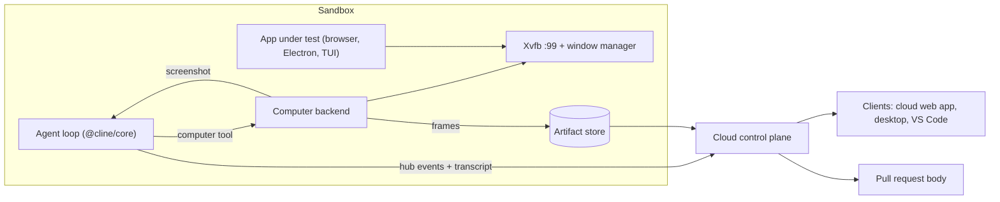

# Computer use: closing the loop in cloud sessions

Status: draft proposal, with clickable demos in the desktop app and the VS Code extension.

## Summary

Cloud sessions already let an agent work on a GitHub repository in a sandbox, stream its tool calls to the client, and open a pull request. The missing step is the one a human engineer always takes before saying "done": run the thing and look at it.

"Computer use" (or "closing the loop") gives the sandboxed agent a virtual display, a way to take screenshots, and a way to click, type, and scroll. After building a feature, the agent launches the app, uses it the way a user would, checks the result with its own eyes (screenshots go back to the model as image input), fixes what it finds, and attaches the best frames to its final answer as visual evidence. Clients render that evidence as a screenshot reel under the completion, and the same frames can go into the PR description.

## Why

- Tests passing is not the same as the feature working. Layout bugs, dead buttons, broken focus handling, unreadable dark mode, and overflowing mobile layouts all pass unit tests.
- Reviewers currently have to check out the branch to see a UI change. A reel of captioned screenshots answers "what does it look like" in seconds and makes cloud PRs much easier to trust.
- Agents that can observe their output self-correct. Seeing a screenshot of a blank page after `bun run dev` is a much stronger signal than an exit code.

## Goals

- The agent can launch and drive GUI apps in the sandbox: web apps in a browser, Electron or Tauri desktop apps, and terminal UIs in a terminal emulator.
- The agent verifies its own work before completing and fixes problems it finds.
- Clients (cloud web app, desktop app, VS Code) show the evidence as a screenshot reel, and live frames while the agent works.
- Screenshots can be embedded in the pull request the agent opens.

## Non-goals for v1

- Live remote-desktop streaming to the client, or letting the user take over the sandbox display.
- Computer use on the user's own machine (local sessions). The tool should be designed so this can be added behind explicit consent later.
- Windows and macOS sandboxes.

## User experience

While the agent works, each computer-use action appears as a normal tool row ("Pressed `ctrl+k`", "Typed `over`", "Clicked at `(640, 228)`") with the resulting screenshot as an expandable thumbnail.

When the run completes, a "Verified in sandbox" reel appears under the final answer:

- One large stage plus a filmstrip of thumbnails. The reel autoplays, and each thumbnail carries a story-style progress bar that fills until the next slide.
- Each frame has a caption that states what it verifies ("Ctrl+K opens the command palette"), the input that produced it ("Pressed `Ctrl+K`"), and a pass or fail mark. Clicks get a pointer marker with a ripple at the click location.
- Playback pauses on hover and on keyboard focus. Arrow keys step, Space toggles, and the play button stays visible. Reduced-motion users get a static reel.
- Frames expand into the host's lightbox.
- Narrow hosts (the VS Code sidebar) use a compact variant with smaller thumbnails and title-only captions.

A frame marked as failed turns the header summary red ("1 failed"), so a reel can also report problems the agent could not fix.

## Architecture



### 1. Sandbox display stack

| Option | What it is | Pros | Cons |
| --- | --- | --- | --- |
| Xvfb + xdotool + ImageMagick (`import`) or `scrot`/`maim` | Virtual X11 framebuffer, synthetic input, screenshot tools | Drives any X11 app (browsers, Electron, Tauri, terminals). Small, mature, scriptable. This is what produced the demo screenshots. | X11 only. Pixel-level, no DOM awareness. |
| Playwright or Chrome DevTools Protocol | Browser automation | Deterministic web screenshots, DOM and accessibility snapshots, viewport emulation, network control | Web only. Cannot drive native windows. |
| Headless Wayland (Weston or Sway) + `grim` + `wtype`/`ydotool` | Wayland equivalent of the X11 stack | Modern compositor, matches newer desktops | Thinner tooling, some input tools need privileges |
| `x11vnc` or noVNC on top of Xvfb | Remote framebuffer | Enables a future live view and user takeover | Extra port and process. Not needed for v1. |
| `ffmpeg -f x11grab` | Screen recording | Short clips or GIFs of a whole flow | Large outputs. Later phase. |

Recommendation: put Xvfb, a lightweight window manager (fluxbox or openbox), xdotool, ImageMagick, Chrome or Chromium, and a reasonable font set (Noto, including emoji) in the base sandbox image. Add Playwright's browser for web-specific checks later. Hide all of it behind one `computer` tool so the backend can change without touching prompts or clients.

Display lifecycle: start the display lazily on the first computer action, at a fixed 1280x800 resolution and device scale factor 1 so token cost stays predictable. Export `DISPLAY` into the environment of commands the agent runs, so `bun run dev`, `npm start`, or `cargo tauri dev` render into the same display the agent is looking at.

### 2. The `computer` tool

Mirror the action schema of the providers' native computer-use tools (Anthropic's computer-use tool and OpenAI's `computer_use_preview`), so models trained on those tools behave well:

| Action | Input |
| --- | --- |
| `screenshot` | none |
| `left_click`, `right_click`, `double_click`, `mouse_move` | `coordinate: [x, y]` |
| `left_click_drag` | `start_coordinate`, `coordinate` |
| `type` | `text` |
| `key` | `text`, for example `ctrl+k` |
| `scroll` | `coordinate`, `scroll_direction`, `scroll_amount` |
| `wait` | `duration` |

Every action returns a fresh screenshot as image content plus a `frameId`. When the active provider supports a native computer-use tool, send the native definition; otherwise expose the same schema as a regular function tool.

Placement: a default tool in `@cline/core` (next to the other executors in `src/extensions/tools/executors/`), behind a capability that cloud sandboxes enable when the display stack is present. The executor talks to a small `ComputerBackend` interface (X11 via xdotool and ImageMagick first, then Playwright, plus a mock for tests). The tool requires a model with image input, the same check `read_files` already performs for images.

Context cost: Claude bills roughly `width * height / 750` tokens per image, so a 1280x800 frame is about 1.4k tokens. Keep only the most recent frames in context and replace older ones with the existing omitted-media placeholder, using the media budget helpers in `@cline/shared` (`DEFAULT_MAX_TOTAL_MEDIA_BYTES`, `IMAGE_OMITTED_PLACEHOLDER`). Downscale before sending and scale coordinates back to screen space.

Evidence selection: the agent should curate the reel rather than dump every frame. The completion carries `verification.frames: [{ frameId, caption, verdict }]`, referencing frames the tool already returned, and the runtime resolves them to stored media.

Phase 0 needs no new tool: an agent can already shell out to `xdotool` and `import`, then call `read_files` on the PNG. `read_files` returns PNG and WebP files as image content to vision models, so the agent can see its screenshots today. Only the path back to the client is missing. The VS Code demo shows this shell-driven flavor, and the desktop demo shows the first-class tool.

### 3. System prompt guidance

When computer use is available, add a short "verify your work" section to the system prompt. Draft:

> After implementing a change that affects anything a user can see or interact with, verify it before completing. Build and start the app, open it on the virtual display, and exercise the changed flow the way a user would. Check the states that usually break: empty, loading, error, long content, dark mode, and a narrow viewport. If something looks wrong, fix it and check again. Finish by selecting 3 to 8 screenshots that show the feature working, each with a one-line caption stating what it verifies and whether it passed. Never capture secrets such as tokens, `.env` contents, or credentials in a screenshot.

### 4. Getting screenshots to clients

What exists today:

- `@cline/core/cloud` (`CloudSessionController`, `CloudSessionApi`) streams hub events and transcript snapshots from the sandbox to hosts.
- Messages already carry `GeneratedMedia` (`@cline/shared`, `llms/media.ts`), whose `source` is `base64`, `url`, or `artifact`. Hosts render inline `base64` today. The `artifact` source exists, but `GeneratedMediaContent` only shows a "stored as an artifact" placeholder because no host resolves artifacts yet.
- The VS Code message translator already maps `media` content events to `ClineMessage.media`, and the desktop transcript renders tool-result images.

Proposal:

1. The sandbox uploads each frame to session-scoped object storage and gets an `artifactId`. Tool results and the transcript carry `{ type: "artifact", artifactId }`, plus a small inline thumbnail (about 320px wide WebP, a few KB) so rows render instantly without a round trip.
2. Hosts get an artifact resolver. The desktop sidecar and the VS Code extension fetch through an authenticated `CloudSessionApi` call (signed URL or bytes) and hand the webview a `blob:` URL. This keeps the existing rule that webviews never bind provider-supplied URLs directly, and it fits the VS Code webview CSP, which blocks `fetch()` to arbitrary origins.
3. A verification contract on the completion: `verification: { frames: [{ media, caption, action, detail, pointer, verdict }] }`. Hosts map it to `AgentScreenshot` from `@cline/ui`.
4. Budgets: thumbnails only inline, a cap on frames per session, and deduplication of identical frames by hash.
5. Security: artifacts inherit session access control, signed URLs are short-lived, and organizations can disable screenshot capture through remote config. Later, optionally redact text that looks like secrets before upload.

### 5. Clients

- `@cline/ui`: `AgentScreenshotCarousel` is the shared reel (this branch). Hosts pass `screenshots: AgentScreenshot[]` with host-approved `src` URLs. It is styled by a framework-neutral stylesheet with `--cline-ui-shots-*` variables, so hosts without Cline tokens (the VS Code webview) can theme it.
- `@cline/ui` tool summaries label `computer` actions (this branch), so any host that renders shared tool summaries gets readable rows.
- Desktop: `ChatMessages` takes a `verification` prop and renders the reel after the transcript, with screenshot expansion through the existing lightbox (this branch). Live tool rows already show tool-result images.
- VS Code: `CompletionOutputRow` renders image `media` attached to the completion as a compact reel (this branch).
- Cloud web app: adopt the same component.
- Pull requests: when the agent opens a PR, the control plane uploads the verification frames and embeds them in the body under a "Verified in sandbox" heading.

### 6. Later: live view and takeover

Stream frames (or run noVNC) so users can watch the agent drive the app in real time, and let them take over the display to show the agent what they mean. This reuses the display stack and needs no change to the tool.

## Phased plan

| Phase | Scope | Main work |
| --- | --- | --- |
| 0 | Demo and prompt experiments | Shell plus `read_files` in the sandbox. UI prototypes in this branch. |
| 1 | First-class computer use | Display stack in the sandbox image, `computer` tool and backend in core, prompt section, inline thumbnails through the existing media transport, reel in all clients |
| 2 | Full-resolution evidence | Artifact store, host resolvers, verification contract, PR embedding |
| 3 | Beyond screenshots | Live view and takeover, recorded clips, local computer use with consent, Wayland |

## Open questions

- Which models get the native provider tool and which get the function-tool fallback, and how do we evaluate their click accuracy?
- Should verification run on every task, only when UI files change, or only on request?
- Is 1280x800 the right default, or should the agent pick a viewport per check?
- How long do we retain screenshot artifacts, and who can see them in team workspaces?
- Should the reel also be posted as a PR comment when the agent updates an existing PR?

## Trying the demos

Both demos replay a scripted cloud session through the real chat UI, because sandboxes cannot send images to clients yet. They are dev-only.

Desktop app (`apps/examples/desktop-app`):

1. Run `bun run dev` (native window) or `bun run dev:headless` (browser at `http://localhost:3125`).
2. Press Cmd/Ctrl+Shift+D, or open `http://localhost:3125/#computer-use-demo` in headless mode.
3. Use Replay or Exit in the composer area.

VS Code extension (`apps/vscode`):

1. Build with `IS_DEV=true bun run build:webview` and `bun esbuild.mjs`.
2. Launch the extension development host with `IS_DEV=true` and `DEV_WORKSPACE_FOLDER=<repo>/apps/vscode` (the repo's launch configurations set both).
3. Open the Cline view and run "Cline: Play Computer Use Demo" from the command palette.

The demo screenshots are real. They come from a small fixture kanban app driven by the same loop an agent would run:

```bash
Xvfb :99 -screen 0 1280x900x24 &
export DISPLAY=:99
google-chrome --app=http://localhost:5173 --window-size=1280,800 &
shot() { import -window root -crop "${2:-1280x800}+0+0" +repage "shots/$1.png"; }

shot 01-board
xdotool key ctrl+k && shot 02-palette
xdotool type --delay 110 over && xdotool mousemove 640 228 && shot 03-search
xdotool click 1 && shot 04-filtered
xdotool key ctrl+k && xdotool type dark && xdotool key Return
xdotool key ctrl+k && xdotool type high && shot 05-dark
xdotool windowsize "$(xdotool getactivewindow)" 390 844 && shot 06-mobile 390x844
```
