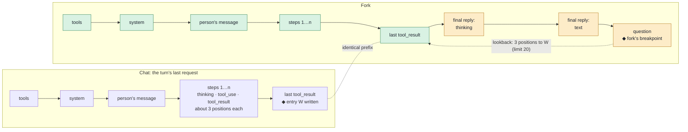
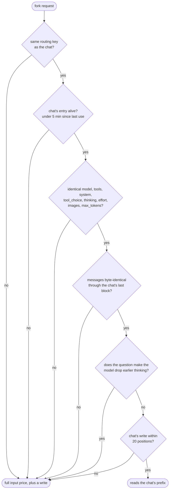

# Prompt cache design

How Next Turn can write its suggestions with the chat's own model while
paying only for what the chat has not already cached. This doc grows one
section at a time:

1. **What makes a fork reuse the chat's cache** (this section)
2. The fork's architecture
3. Work ahead of time: checkpoints, compaction and token thresholds
4. Hub events and commands
5. Cost model

A *fork* is one extra model call made right after a turn ends. It sends the
chat's last request again, with the turn's final reply and one question
appended. Nothing about it is written to the chat.

## 1. What makes a fork reuse the chat's cache

### The short answer

The fork reads the chat's cache when **all** of these hold:

- it reaches the same upstream as the chat (same routing key);
- the chat's entry is still alive (Anthropic: 5 minutes since it was last
  written or read);
- everything before the messages is identical: model, tools, system prompt,
  `tool_choice`, the thinking and effort settings, and whether images appear;
- its messages start with the chat's last request **byte for byte**;
- the chat's last cache write sits within 20 positions of the fork's
  breakpoint (Anthropic's lookback window).

Build the fork from the request object the chat actually sent, through the
same SDK code path, and the first four hold by construction. Send it as the
turn ends and the fifth holds on the Cline and OpenRouter routes: the fork
adds about three positions.

### How a prompt cache matches

Providers cache a request's *prefix*. Anthropic renders a request as
`tools → system → messages`. A change at one level invalidates that level and
everything after it. Cache entries are written only at *breakpoints*. A later
request finds an entry by walking back from its own breakpoint, at most 20
positions. A run of consecutive `tool_use` blocks counts as one position, and
so does a run of consecutive `tool_result` blocks.

A hit is billed as a cache read: 0.1× the input price, 0.05× on Opus 5.5 and
Sonnet 5.5, and 0.025× on Fable 5.1. New input up to the breakpoint is billed
as a write at 1.25×. An entry lasts 5 minutes and each read refreshes it for
free. It becomes readable only once the first response that wrote it has
begun.
([Anthropic](https://platform.claude.com/docs/en/build-with-claude/prompt-caching))

OpenAI models cache automatically. A request reuses the longest cached
prefix, looking back through up to 20 earlier message endings. `model`,
`tools`, `parallel_tool_calls`, `text.format` and `reasoning.effort` can all
change the rendered prefix. An in-memory entry typically lives 5 to 10
minutes while unused.
([OpenAI](https://developers.openai.com/api/docs/guides/prompt-caching))

### What the SDK sends

Next Turn reuses the chat's provider, so the fork inherits whatever cache
markers the SDK writes for that provider. I checked each route below by
streaming the same messages through `createGateway` with a stubbed `fetch`,
then reading the request body.

| Route | Cache markers in the body | Where the chat's last write lands |
|---|---|---|
| `cline`, `cline-pass` | top-level `cache_control` (automatic caching) and one on the person's message | the request's last block, so it moves with every step |
| `openrouter` | the same, plus `session_id` | the same |
| `anthropic` (direct) | one on the person's message only (see [Findings outside the plugin](#findings-outside-the-plugin)) | the person's message, for the whole turn |
| `bedrock` | one `cachePoint` after the person's message | the person's message, for the whole turn |
| Models with no Anthropic-style route (GPT, GLM, Kimi, DeepSeek, Gemini) | none; the provider caches implicitly | the provider's longest matching prefix |

Explicit markers go on the last `role: "user"` message
([`buildAiSdkRequestMessages`](../../../../packages/llms/src/providers/ai-sdk.ts)).
Tool results are `role: "tool"` messages in the AI SDK prompt, so within a
turn the explicit marker stays on the message that opened the turn. On the
Cline and OpenRouter routes, it is the top-level field that keeps tool steps
cached.

The chat's own usage bears this out. These are the chat requests of at least
20K input tokens in this machine's 300 most recent sessions, all on the
`cline` provider. The provider reports no cache writes, so the read ratio
below is cache-read tokens over input tokens.

| Request | n | Median read ratio | Read ≥ 80% |
|---|---|---|---|
| Tool step | 18,257 | 0.99 | 90% |
| A turn's final step | 652 | 0.99 | 90% |
| First request of the next turn | 853 | 0.00 | 35% |

### The request layout

The fork is the chat's last request plus two messages. The chat's last
request is the one that produced the final reply, and its input ends at the
last tool result. On the Cline and OpenRouter routes, the automatic
breakpoint wrote entry **W** at that last block. The fork's own breakpoint
lands on the question, three positions later, so its lookback finds W.

Green blocks are read from W. Amber blocks are new input, billed as a write
at the fork's breakpoint: the final reply (median 963 output tokens, thinking
included) and the question.

The same stubbed-`fetch` check, on the `cline`, `openrouter` and direct
`anthropic` routes, showed:

- **Messages:** the fork's first messages equal the chat's, byte for byte
  once cache markers are set aside.
- **Other fields:** every other field matches (`model`, `tools`,
  `tool_choice`, `reasoning_effort` or `thinking` and `output_config`,
  `provider`, `session_id`, `max_tokens`).
- **Signatures:** the direct `anthropic` route keeps each thinking block's
  signature. The OpenAI-compatible wire of `cline` and `openrouter` sends
  `reasoning_content` without one. It does so for the chat and the fork
  alike, so the prefixes still match.

### What breaks a fork's read

Each check, and how the fork keeps it:

- **Routing key.** On `cline` and `cline-pass`, `X-Task-ID` is the session
  ID. The Cline API turns it into a body `session_id` and the
  `x-session-affinity` header, and it picks the upstream provider
  deterministically per model and user. On `openrouter`, the SDK writes
  `session_id` from the request's `metadata.sessionId`. OpenRouter keeps a
  session on one provider endpoint until it has been idle for 10 minutes. The
  planner already passes the chat's session ID to
  `resolveProviderRequestHeaders`. The fork keeps the chat's `options`,
  `metadata` included.
- **Entry age.** The fork runs at `afterRun`, seconds after the chat's last
  read refreshed the entry. A turn's final step is the same situation one
  step earlier: in 87% of final steps, the read covered at least 95% of the
  previous request's input (n=652).
- **Settings before the messages.** Anthropic renders the thinking
  configuration and `output_config.effort` into the prompt, so changing
  either invalidates the messages cache. A change to `tool_choice`, or adding
  or removing an image, does the same. So the fork cannot turn reasoning off,
  set `tool_choice: "none"` to stop tool calls, or ask for structured output
  (`text.format` adds instructions on OpenAI). It keeps the chat's tools and
  settings, ignores any tool call, and parses its answer from text.
- **`max_tokens`.** This is not on Anthropic's list. But OpenRouter derives
  an Anthropic thinking budget from `max_tokens` when the request names an
  effort
  ([reasoning tokens](https://openrouter.ai/docs/guides/best-practices/reasoning-tokens)),
  and a budget change invalidates the cache. The fork keeps the chat's
  `max_tokens` (`options.maxTokensPerTurn` on the captured request). It
  bounds its cost another way: it stops reading the stream once three rows
  parse, with a timeout behind that.
- **Byte-identical messages.** Replay the `request` object captured in
  `beforeModel`; do not rebuild it from session storage. That object is taken
  after compaction and any queued input, which storage may not reflect. Then
  append two messages: the turn's final assistant message as the run returned
  it (`afterRun`'s `result.messages`, reasoning metadata included) and one
  user message with the question. A `beforeModel` hook that runs after Next
  Turn's could still change the request; the cache-read check in the gate
  catches that.
- **Dropped thinking.** Some models remove earlier thinking from the prompt
  once a user message that is not a tool result arrives. The documented cases
  are Anthropic models before Opus 4.5 and Sonnet 4.6, and Haiku through 4.5.
  For those, the fork's question changes the prefix from the first thinking
  block onward.
- **Lookback.** On the Cline and OpenRouter routes, the fork adds about three
  positions after W. On the direct `anthropic` and `bedrock` routes, W sits on
  the person's message. Each tool step takes about three positions (thinking,
  `tool_use`, `tool_result`), and the fork adds three more. So W is out of
  reach once a turn has more than five tool steps, which is 56% of turns
  (median 7, p75 20, n=1,032).

### The gate

The fork goes ahead only when the usage the chat just reported says the cache
is warm. Otherwise the summary planner answers.

- The turn completed in text.
- The turn's final model call read at least half its input from cache. A
  chat that does not cache its own steps will not cache a fork. Among tool
  steps, `claude-haiku-5.5` reads nothing (median 0.00, n=132), and the
  `gpt-5.6-sol-pro` and `gpt-6.1-sol-pro` models read about three quarters
  (medians 0.76 and 0.78).
- The capture is under 4 minutes old.
- The request has no binary parts, since hook payloads cross the plugin
  sandbox as JSON.
- A fork that missed, failed or timed out turns the fork off for that model
  for the rest of the chat.

The nearest measured case is the person's own next message, sent within 30
seconds of a reply that passed the gate. It has the fork's shape: a user
message appended after the final reply. It read at least 50% from cache in
83% of cases and at least 80% in 63% (n=133). Of the rest:

- in 20 the context shrank (compaction, an undo, or a model that renders
  fewer earlier tokens on a new turn);
- in 13 nothing was read;
- in 16 the read was partial.

The fork's real hit rate goes to `planner.jsonl` once instrumentation lands.

### What a miss costs

A cold first request costs 7 to 30 times a warm one. Median cost per 100K
input tokens, for a turn's first request with under 2K output:

| Model | Warm (read ≥ 80%) | Cold (read ≤ 5%) |
|---|---|---|
| Claude Opus 5.5 | $0.028 (n=34) | $0.406 (n=88) |
| Claude Sonnet 5.5 | $0.025 (n=26) | $0.204 (n=48) |
| Claude Fable 5.1 | $0.032 (n=12) | $1.007 (n=16) |
| GPT-5.6 Sol | $0.024 (n=21) | $0.203 (n=10) |
| GLM-5.3 | $0.019 (n=43) | $0.141 (n=28) |

A fork pays the warm price, plus a write on the amber blocks and its own
output, thinking included. The chat's reasoning settings must stay
unchanged, so the fork thinks the way the chat does. That cost and latency,
against the summary planner with reasoning off, is what instrumentation will
measure. Section 5 covers the full cost model.

### Findings outside the plugin

Both affect every chat on these routes, not just the fork, and belong in a
separate SDK change.

- **Direct `anthropic` sends no top-level `cache_control`.**
  `buildAnthropicProviderOptions` puts `cache_control` in the `anthropic`
  provider-options bucket. `@ai-sdk/anthropic` reads only `cacheControl` for
  the top-level field, and its options schema strips the snake-case key. With
  a stubbed fetch, `{ cache_control }` sends no top-level field and
  `{ cacheControl }` sends it. The block-level marker on the person's message
  survives, because the per-block reader accepts both spellings.
- **The breakpoint never reaches a tool result on `anthropic` or `bedrock`.**
  The explicit marker goes on the last `role: "user"` message, and tool
  results are `role: "tool"`. So within a turn the cached prefix stops at the
  person's message, and every tool step pays full input for the turn's tool
  history so far. This is inferred from request bodies, not measured: this
  machine has no sessions on these routes. The pre-SDK Bedrock handler marked
  the last two user messages, tool results included.

### Not verified

- Whether OpenRouter honors the message-level `cache_control` that the
  OpenAI-compatible wire puts on a single-text user message. Top-level
  automatic caching covers the Cline and OpenRouter routes either way.
- What an Anthropic upstream does with thinking replayed as
  `reasoning_content` without a signature. The chat and the fork send the
  same thing.
- Why some GLM-5.3 next turns report a smaller context. Of 33, 20 still read
  at least 80%.
- How the Cline API forwards `session_id` to an OpenAI upstream, which routes
  by `prompt_cache_key`. GPT tool steps read a median of 0.99 regardless.

### Sources

- **Code:**
  - `@cline/llms`: `providers/ai-sdk.ts`, `providers/routing/*`.
  - `@cline/agents`: `agent-runtime.ts` (`beforeModel` receives the request
    after compaction).
  - The Cline API: `chat/service.go`, `provider/client.go`,
    `transport/session_headers.go`, `provider_router/routing.go`.
- **Docs**, fetched 2026-10-16:
  - [Anthropic prompt caching](https://platform.claude.com/docs/en/build-with-claude/prompt-caching)
  - [OpenAI prompt caching](https://developers.openai.com/api/docs/guides/prompt-caching)
  - [OpenRouter prompt caching](https://openrouter.ai/docs/guides/best-practices/prompt-caching)
  - [OpenRouter reasoning tokens](https://openrouter.ai/docs/guides/best-practices/reasoning-tokens)
- **Data:** `~/.cline/data/sessions/*/*.messages.json`, the 300 most recent
  sessions as of 2026-10-16, requests of at least 20K input tokens.
