# What's new in Cline

Covers everything merged since the Oct 16 releases (Desktop 0.0.48, CLI 3.0.73, SDK 0.0.95, VS Code 4.1.25). About 70 PRs.

---

## Cline Desktop

### Run models on your own machine
New **Settings → Provider → Local** page for running models locally with Ollama or LM Studio, no terminal needed.
- Shows your machine (CPU, RAM, GPU) and labels each recommended model "Runs well", "Will run slowly", or "Too large", with a "Recommended for you" pick.
- Detects whether Ollama and LM Studio are installed and running, and can start them for you.
- Download (with progress), load, unload, and delete models. **Use with Cline** switches your chat to that model with the right context window.
- "Loaded in memory" shows what's using RAM right now, and "Downloaded models" shows disk usage and asks before deleting.
- A chip under the message box shows how much memory the local model is using, with a one-click Unload.

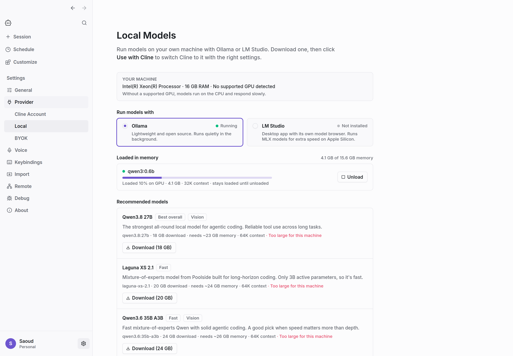
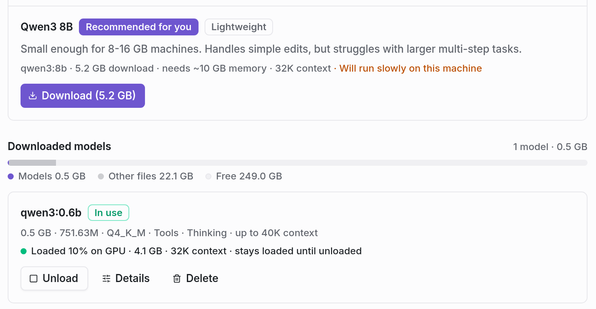
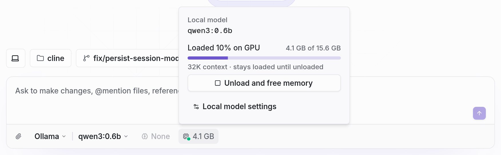

### Provider settings, regrouped
Cline Account, Local, and BYOK (bring your own key) now sit under one **Provider** group in Settings. Clicking it opens the provider your chat is using right now, marked **In use**. The Cline Account page also shows a ClinePass card with the models it includes.

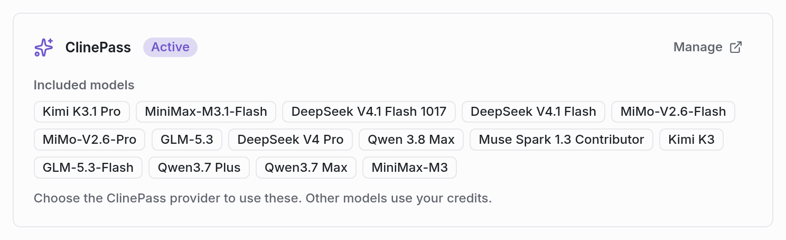

### Your project, right next to the chat
Open the new workspace panel from the session header to see your project without leaving Cline.
- **Git tab:** staged and unstaged changes, recent commits, and Stage / Discard buttons. Files Cline changed in this session are marked.
- **Files tab:** browse the whole project, open files in tabs with syntax highlighting, and switch between File and Diff for anything Cline edited.

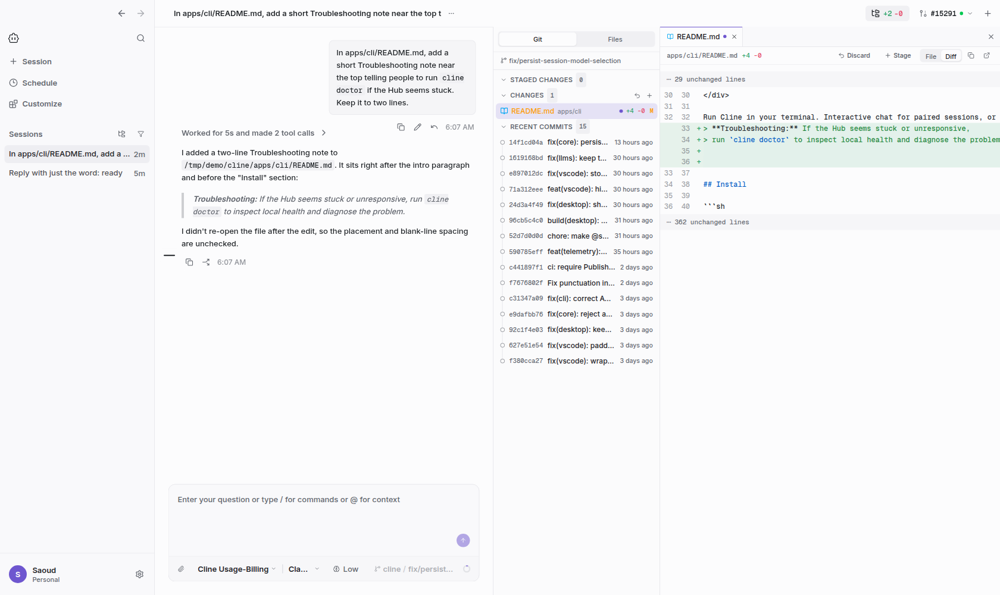
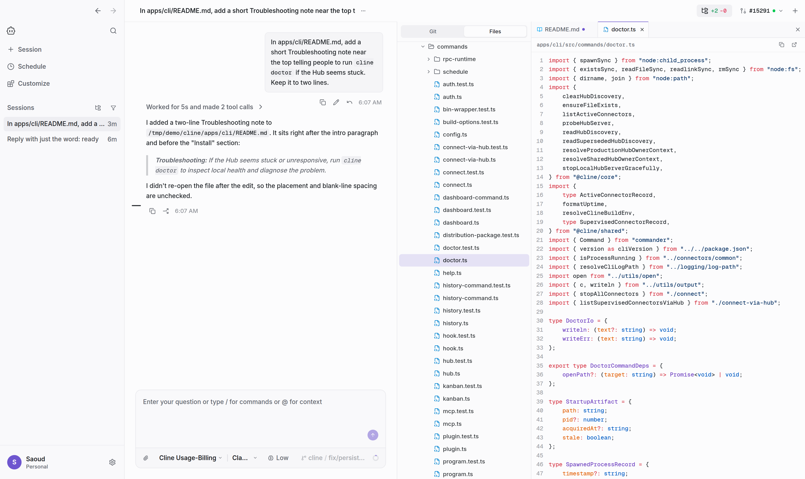

### See exactly what Cline just changed
When a turn finishes, a small summary card under it lists the files it changed (for example "Changed 1 file +3 -0"). Click it, or the new **Changes** button in the header, to open a Changes pane with **Last turn** and **Session** tabs and a diff for each file. Your own unrelated edits stay out of it, and **All uncommitted changes** jumps to the Git view.

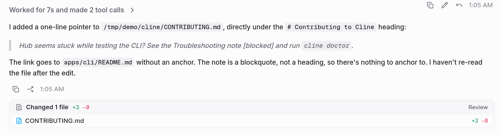
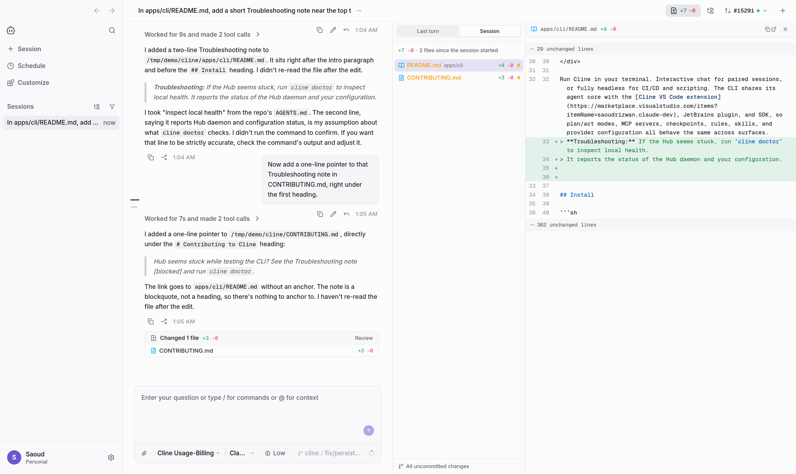

### A real terminal, built in
Press **Ctrl+`** (or click Terminal) to open a terminal drawer under the conversation, already in your project folder. Open more tabs with +.

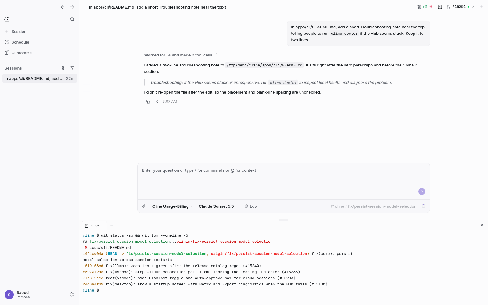

### Pull request status at a glance
The full-width PR bar above the chat box is now a compact button in the header. It shows the PR number and CI status, and its menu has the title, merge status, line counts, every check (failures first), Open on GitHub, Copy branch name, and Refresh. No PR yet? It offers "Create pull request".

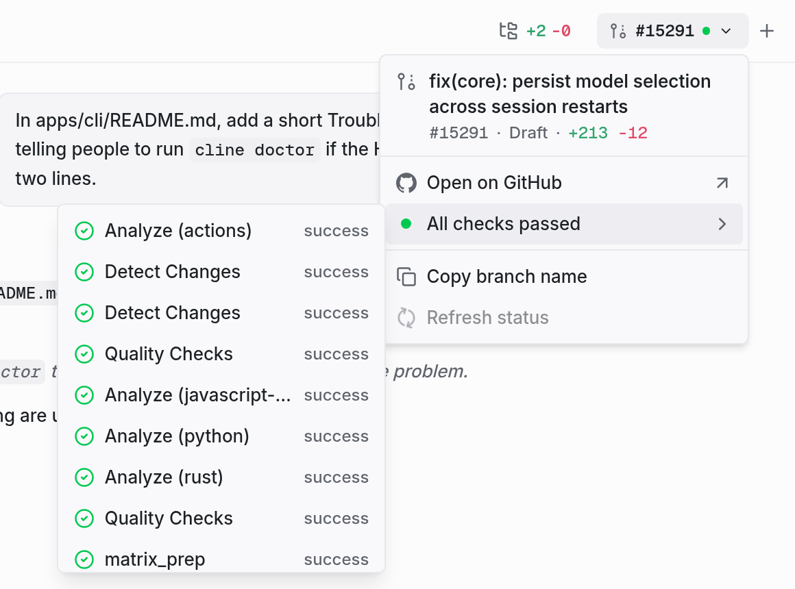

### Commands and files light up as you type
When your message starts with a command Cline will actually run (like `/compact`, `/fork`, `/team`, or a skill or workflow), it turns into a chip. `@file` mentions that point at real files get a chip too, so you can tell they'll be attached.

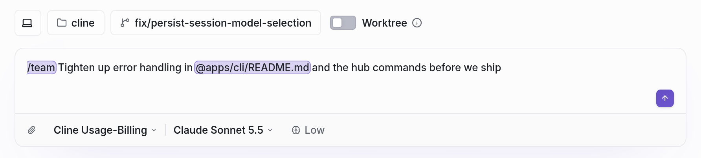

### Your shortcuts, your way (and no more accidental ⌘Q)
New **Settings → Keybindings** page: click a shortcut to record a new one, unbind it, or reset it. On macOS, **⌘Q now has to be held for a second** to quit, so a stray tap no longer closes your sessions (set the hold to 0 to go back to instant quit).

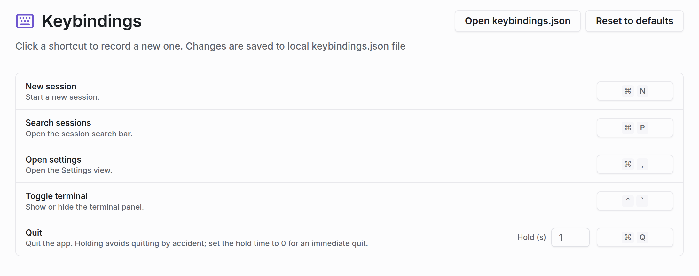

### A clear screen when something goes wrong at startup
If Cline's background service (the Hub) doesn't start, you now get a clear message with **Retry** and **Export diagnostics** instead of confusing errors later. If the Hub comes back on its own, the app opens automatically.

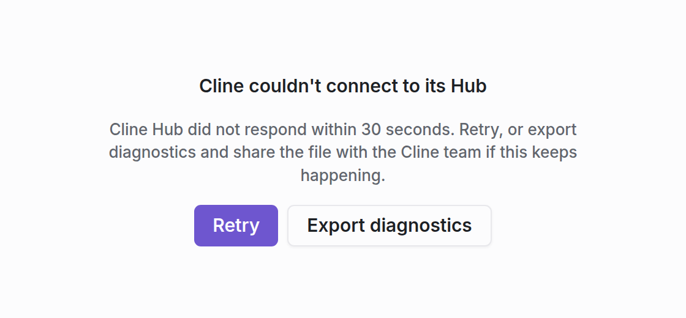

### See and restart the Hub from Settings
Settings → General now shows the Hub's address, connected clients, and recent events, with a **Restart Hub** button. Export diagnostics has its own Debug section, and Check for updates moved to About.

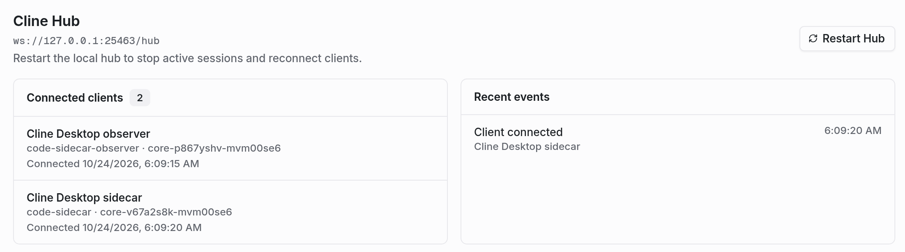

### Also in this release
- Cloud sessions keep running and stay in sync even if you close or restart the app.
- New Cloud chats start on the Cline or ClinePass model you already use locally (falling back to ClinePass or Claude Sonnet 5.5), and automatic fallbacks no longer get stuck as your default.
- Schedules show live run status and the full error message when a run fails.
- The sidebar remembers whether you sort by Sessions or Projects.
- Pasting a Cline API key now replaces an old browser sign-in, and the API key field no longer overflows the settings panel.
- Linux: closing the window quits the app on desktops without a system tray (stock GNOME), instead of leaving it running invisibly.
- SSH remotes reached through a ProxyJump host now connect reliably.
- Long lines now wrap in the file, diff, and Changes viewers, so there's no more sideways scrolling.
- A model picked in Settings while Cline is working is applied when the turn ends, instead of being dropped.
- Session titles no longer end with a stray `</user_` tag.
- Answering one of Cline's questions no longer shows raw `<hook_context>` text in the conversation.
- Diagnostics exports reach much further back in the Hub log, so reports about stuck tasks include what happened.

---

## Cline for VS Code

### Watch your cloud sandbox get ready
Starting a cloud task now shows a progress card (Start sandbox, Clone repository, Start agent) instead of a plain line and a misleading "Thinking...". Once the agent starts, it shrinks to a compact "Cloud sandbox: repo / branch" marker.

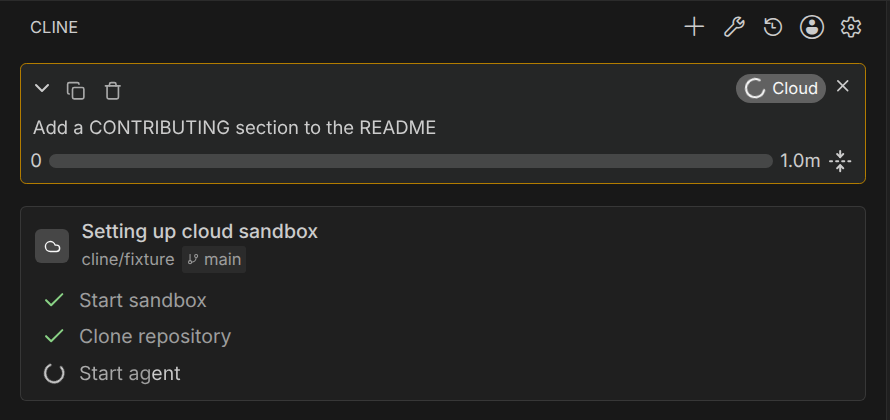

### A cleaner composer for cloud tasks
Cloud tasks always run in Act mode with auto-approve, so the Plan/Act toggle and auto-approve bar are now hidden for them. Local tasks are unchanged.

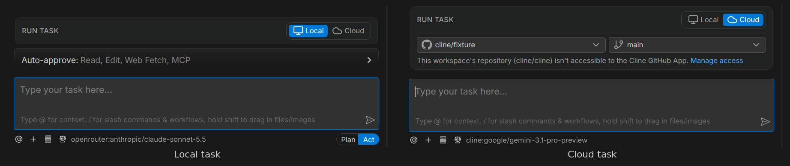

### Choose the model your cloud tasks use
Settings → API Configuration has a new **Local | Cloud** toggle. Cloud shows a Cline model picker with **Usage-Billing**, **ClinePass**, and **ClineFree** tabs, saved separately from your local Plan/Act models. Clicking the model name under the chat box in a cloud task takes you straight there. If you haven't picked one, cloud tasks use your local Cline or ClinePass model when the cloud offers it, otherwise Claude Sonnet 5.5.

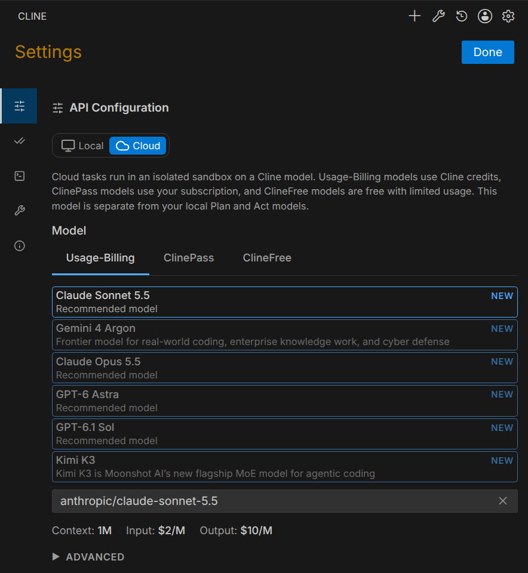

### Also in this release
- Turning a rule off in the Rules panel now actually removes it from what Cline sees.
- Switching Plan/Act right after sending a task no longer drops your first message or leaves Cline stuck with Plan-mode tools.
- Cline running a command no longer steals keyboard focus from the chat box, so your typing doesn't end up in the terminal.
- "View Changes" after a task is much faster in big repos with lots of untracked files.
- Gemini free-tier API keys work again (no more quota errors from built-in Google Search).
- In a narrow sidebar, the task header wraps instead of hiding the close button.
- SAP AI Core works with GPT-5 models, and GPT-6 models work on OpenAI-compatible and Azure endpoints.

---

## Cline CLI

- `cline doctor` and `cline hub status` no longer hang when the Hub is frozen; they report it within a few seconds.
- Editors connected over ACP can change models again (provider and model pickers were mixed up).
- Far fewer unnecessary context compactions after the first one, and custom models no longer start with a "Compaction skipped" message.
- Plugins load in standalone and SSH-copied CLI builds, and plugin commands run inside your current session so they share its state.
- Cleaner skills tool labels.

## Smarter everywhere (Desktop, VS Code, CLI)

- If the connection drops while the model is still thinking, Cline retries the turn automatically instead of failing.
- The "max" reasoning level is passed through to models that support it.
- Free models served through Vercel now get the right context and output limits.

---

## SDK 0.2.0 (for developers)

- Versions jump from 0.0.95 to **0.2.0**, and **`@cline/ui`** now ships alongside the other SDK packages on the same version.
- New `summarizeConversation` API, plus support for continuing a local conversation as a cloud task.
- Plugin commands are exposed through `ClineCore` and the Hub (`pluginCommands.list / run / subscribe`).
- Cloud session orchestration moved into the Hub (`HubCloudSessionService` / `HubCloudSessionClient`), so cloud work survives client restarts.
- Groundwork for MCP Resources and MCP Apps (not user-visible yet).
- AI SDK updated to the release line with portable `max` reasoning.
- Per-run stall telemetry to track hangs and early stops.
- New `fetchCurrentUserPlan` account RPC op, and `fetchClineRecommendedModels` now keeps the feed's `clineCloud` model list.
